<div align="center">

<a href="https://leonardodamascenodev.github.io">
  
</a>

<br>

[](https://leonardodamascenodev.github.io)
[](https://github.com/leonardodamascenodev/blueprint-crew)
[](https://www.linkedin.com/in/leonardo-correia-damasceno-aa56062aa/)

</div>

---

## `FOLHA 01/05` · Olá, eu sou o Leo! 👋

Sou um dev em constante evolução, apaixonado por tecnologia e convencido de que o aprendizado nunca para. Hoje estou focado em dominar **HTML, CSS e JavaScript** de verdade, transformando café em código (e bugs em aprendizado).

```text
▸ estudando     HTML · CSS · JavaScript, a fundo, no SENAI
▸ construindo   o blueprint-crew, efeito open-source de cursores que montam sites
▸ aberto a      colaborações em projetos open-source pra iniciantes
```

---

## `FOLHA 02/05` · Projetos em destaque

<table>
  <tr>
    <td width="50%" valign="top">
      <sub>PORTFÓLIO · HTML · CSS · JS PURO</sub>
      <h3><a href="https://leonardodamascenodev.github.io">leonardodamascenodev.github.io</a></h3>
      Uma planta azul que se monta enquanto você rola: sete cursores com nome desenham os blocos, arrastam as peças e digitam os títulos. Tem nome em 3D e modo escuro cyberpunk.
      <br><br>
      <a href="https://leonardodamascenodev.github.io"><b>▸ abrir o portfólio</b></a>
    </td>
    <td width="50%" valign="top">
      <sub>OPEN-SOURCE · PLUGIN DO CLAUDE CODE</sub>
      <h3><a href="https://github.com/leonardodamascenodev/blueprint-crew">blueprint-crew</a></h3>
      O efeito do meu portfólio virou ferramenta: um comando aplica os cursores em qualquer site ou seção, com temas, cor gerada a partir da sua marca e zero dependências.
      <br><br>
      <a href="https://github.com/leonardodamascenodev/blueprint-crew"><b>▸ ver o repositório</b></a>
    </td>
  </tr>
  <tr>
    <td width="50%" valign="top">
      <sub>E-COMMERCE · FRONT-END</sub>
      <h3><a href="https://leonardodamascenodev.github.io/dust-ecommerce">Dust</a></h3>
      Projeto de e-commerce publicado no GitHub Pages.
      <br><br>
      <a href="https://leonardodamascenodev.github.io/dust-ecommerce"><b>▸ abrir o site</b></a>
    </td>
    <td width="50%" valign="top">
      <sub>EQUIPE · SENAI · GRUPO 6</sub>
      <h3><a href="https://github.com/leonardodamascenodev/livraria-api-grupo6">livraria-api-grupo6</a></h3>
      API da livraria desenvolvida em equipe, com requisitos, estimativas e tarefas organizadas em issues.
      <br><br>
      <a href="https://github.com/leonardodamascenodev/livraria-api-grupo6"><b>▸ ver o repositório</b></a>
    </td>
  </tr>
</table>

> [!TIP]
> Quer o efeito do meu portfólio no seu site? No Claude Code:
> ```text
> /plugin install blueprint-crew --marketplace leonardodamascenodev/blueprint-crew
> ```

---

## `FOLHA 03/05` · Stack

<p align="left">
  
</p>

| Linguagens | Front-end | Ferramentas |
|:--|:--|:--|
| JavaScript · C++ · Python | HTML5 · CSS3 · React | Git · GitHub · GitHub Pages · Claude Code |

---

## `FOLHA 04/05` · Estatísticas

<p align="center">
  
  
</p>

<p align="center">
  
</p>

<details>
<summary><b>▸ Atividade recente</b></summary>
<br>

<!--START_SECTION:activity-->
1. ℹ️ Assigned issue [#14](https://github.com/leonardodamascenodev/livraria-api-grupo6/issues/14) in [leonardodamascenodev/livraria-api-grupo6](https://github.com/leonardodamascenodev/livraria-api-grupo6)
<!--END_SECTION:activity-->

</details>

---

## `FOLHA 05/05` · Bora codar junto?

<div align="center">

[](https://www.linkedin.com/in/leonardo-correia-damasceno-aa56062aa/)
[](https://www.instagram.com/leoodamasceno_/)
[](https://discord.gg/wagxzStdcR)
[](mailto:leonardocorreiadamasceno@gmail.com)

<br>

<table>
  <tr>
    <td><sub>PROJETO</sub><br><b>perfil.dev</b></td>
    <td><sub>AUTOR</sub><br><b>Leonardo Correia Damasceno</b></td>
    <td><sub>ONDE</sub><br><b>SENAI</b></td>
    <td><sub>COMBUSTÍVEL</sub><br><b>café</b></td>
    <td><sub>STATUS</sub><br><b>em constante evolução</b></td>
  </tr>
</table>

</div>
